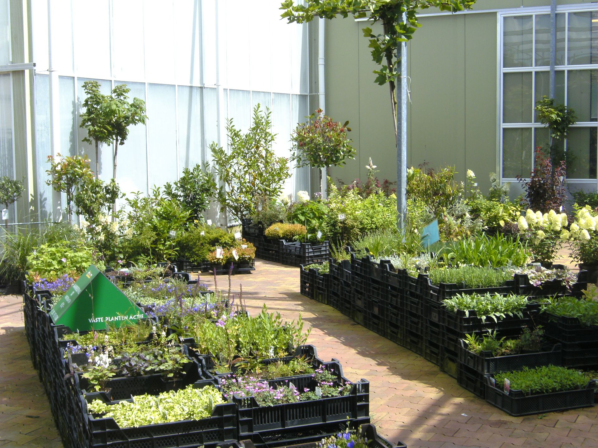

# Kwekerij Bussink – website met beheerpagina

Statische website voor GitHub Pages. De klant past teksten en foto's aan via `admin.html`
(geen link naar die pagina op de site zelf; je geeft de klant het adres).

```
index.html, winkel.html, ...   de pagina's
css/style.css                  opmaak (kleuren en maten staan bovenaan)
site.js                        menu, foto-schuifbalk, laadt wijzigingen uit content.json
content.json                   de wijzigingen van de klant (begint leeg)
admin.html / admin.js / .css   de beheerpagina
admin-config.json              ontstaat bij het instellen (versleuteld token)
images/                        foto's (nieuwe uploads komen in images/uploads/)
tools/optimize-images.py       verkleint foto's (optioneel)
```

---

## Stap 1 – GitHub-account voorbereiden

1. Heb je geen account? Maak er een op github.com.
2. **Zet tweestapsverificatie aan** (Profielfoto → Settings → Password and authentication → Two-factor authentication). Wie in je account komt, komt in de website.

## Stap 2 – Repository maken en bestanden uploaden

1. Klik rechtsboven op **+ → New repository**. Naam bijv. `kwekerij-bussink`, kies **Public**, vink niets anders aan, **Create repository**.
   (Gratis GitHub Pages werkt alleen met een publieke repository. Dat is geen probleem: er staan geen geheimen in.)
2. **Wat upload je?** Alles uit deze map, inclusief `admin.html`, `admin.js`, `admin.css`, `content.json`, `.nojekyll`, `css/` en `images/`.
   Niet nodig: `README.md` en `tools/` (mag wel).
3. **Hoe upload je?** Het makkelijkst is **GitHub Desktop** (desktop.github.com):
   *File → Add local repository* (of *Clone*), zet de bestanden in de map, schrijf onderaan een korte omschrijving, klik **Commit to main** en daarna **Push origin**.
   Via de website kan ook (*Add file → Upload files*), maar GitHub accepteert daar maximaal 100 bestanden per keer:
   upload dan eerst alles behalve `images/`, en daarna `images/` apart.
   Controleer dat `index.html` direct in de hoofdmap van de repository staat, niet in een submap.

## Stap 3 – GitHub Pages aanzetten

1. In de repository: **Settings → Pages**.
2. Onder *Build and deployment* → *Source*: **Deploy from a branch**. Branch: **main**, map: **/ (root)**. **Save**.
3. Na 1 à 2 minuten staat bovenaan de pagina het adres: `https://<gebruikersnaam>.github.io/kwekerij-bussink/`.
   Eventueel kun je daar later een eigen domein koppelen.

## Stap 4 – Beheer instellen (eenmalig)

De site draait zonder server, dus de beheerpagina schrijft via GitHub zelf. Dat gaat met een **token**: een sleutel die *alleen* deze ene repository mag wijzigen.

1. GitHub → profielfoto → **Settings → Developer settings → Personal access tokens → Fine-grained tokens → Generate new token**.
2. Naam bijv. `Beheer Kwekerij Bussink`. *Expiration*: kies een zo lang mogelijke looptijd en zet een herinnering in je agenda.
3. *Repository access* → **Only select repositories** → kies de website-repository. **Dit is belangrijk voor de veiligheid.**
4. *Permissions* → *Repository permissions* → **Contents: Read and write**. Verder niets.
5. **Generate token** en kopieer het (je ziet het maar één keer).
6. Open `https://<gebruikersnaam>.github.io/kwekerij-bussink/admin.html`. Je ziet **Beheer instellen**:
   vul de repository (`gebruikersnaam/kwekerij-bussink`), branch `main`, het token en een **wachtwoord voor de klant** in (minimaal 12 tekens, liefst een zin van een paar woorden).
7. Klaar. Het token wordt in je browser versleuteld met dat wachtwoord en als `admin-config.json` in de repository gezet.
   Geef de klant het adres van `admin.html` en het wachtwoord. Het token zelf hoeft niemand te kennen of te bewaren.

Verloopt het token na een tijd? Maak op dezelfde manier een nieuw token en kies op de loginpagina **Beheerder? Instellingen wijzigen**.

## Stap 5 – De klant aan het werk

1. Ga naar het adres van `admin.html`, log in met het wachtwoord.
2. Kies een pagina, pas tekst of foto's aan. Bij lijsten (acties, winkelfoto's, galerij, openingstijden) kun je onderdelen toevoegen, verwijderen en verplaatsen.
3. Klik op **Opslaan en publiceren**. Na 1 à 2 minuten staat het online.

Foto's worden in de browser automatisch verkleind (max. 1800 px). Bij *Origineel terugzetten* komt de standaardtekst uit de HTML terug.

---

## Hoe veilig is dit?

**Goed:**
- Er draait geen server en er is geen database, dus er valt niets te "hacken" aan de site zelf.
- Het token geeft alleen toegang tot deze ene repository (en alleen het bestandsbeheer daarvan), niet tot je account of andere repositories.
- Het token staat nergens leesbaar: alleen versleuteld (AES-256, 600.000 PBKDF2-rondes) in `admin-config.json`.
- De beheerpagina zet teksten nooit als HTML in de pagina, dus ingevoerde tekst kan geen code uitvoeren.

**Let op, eerlijk:**
- `admin.html` en `admin-config.json` zijn voor iedereen op internet te openen (zoals alles op GitHub Pages). De enige beveiliging is het **wachtwoord**. Wie dat raadt of van de klant krijgt, kan de website wijzigen (niet meer dan dat). Kies dus een lang wachtwoord, deel het niet via openbare kanalen en wijzig het als iemand vertrekt (opnieuw instellen, stap 4).
- Je kunt de wijzigingen altijd terugdraaien: GitHub bewaart elke versie (repository → *Commits* → de commit openen → *Revert*).
- Het adres van de beheerpagina staat niet op de site. Wil je het nog minder vindbaar maken, hernoem dan `admin.html` naar iets onraadbaars (bijv. `beheer-7k2x.html`); `admin.js` en `admin.css` kunnen blijven staan.
- Zet nooit wachtwoorden of tokens zelf in de repository.

## Zelf iets aanpassen in HTML en CSS

- **Kleuren, lettertype, afronding, breedte:** bovenaan `css/style.css`, onder *1. INSTELLINGEN*.
- **Tekst of foto die de klant mag wijzigen** heeft in de HTML een `data-key`:
  ```html
  <h1 data-key="home.titel" data-label="Titel">Welkom bij Kwekerij Bussink</h1>
  
  ```
  De tekst in de HTML is de *standaard*; staat er iets in `content.json`, dan wint dat. `data-label` is de naam in de beheerpagina,
  `data-type="paragraphs"` maakt er meerdere alinea's van, `data-section` bepaalt onder welke kop het in de beheerpagina staat.
  Een **nieuw bewerkbaar veld** maken: geef het element een unieke `data-key`. De beheerpagina pakt het zelf op.
- **Lijsten** (acties, galerij, openingstijden) zijn een element met `data-list="naam"` waarin elk onderdeel `data-item` heeft en elk veld `data-field="naam"`. Het eerste onderdeel is de sjabloon voor nieuwe onderdelen. Zie `acties.html`.
- **Menu en voettekst** staan in elke pagina apart; pas je ze aan, doe dat in alle zes de bestanden.
- **Lokaal bekijken:** `python -m http.server 8000` in deze map, ga naar http://localhost:8000. (Dubbelklikken op een HTML-bestand werkt niet goed.)

## Foto's verkleinen

Voor nieuwe foto's die je zelf in `images/` zet: `pip install Pillow`, dan `python tools/optimize-images.py`.

## Contactformulier

Het formulier gaat via **formsubmit.co** (geen server nodig):
1. Verstuur de eerste keer zelf een testbericht via de live site.
2. `info@kwekerij-bussink.nl` krijgt een bevestigingsmail; klik op de activatielink, anders komen berichten niet aan.
3. Spambescherming: een verborgen vallenstrikveld plus de ingebouwde captcha van formsubmit.

TrustCaptcha is bewust niet gebruikt: het token moet op een server met een geheime sleutel worden gecontroleerd, en die is er hier niet.
